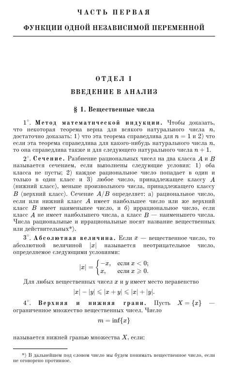

# Демидович — сборник задач по математическому анализу · OCR PDF

**Б. П. Демидович. «Сборник задач и упражнений по математическому анализу»** — электронная версия с распознанным текстом, заново набранными формулами и книжной навигацией.

**[Скачать PDF — 622 страницы, около 11 МБ](https://github.com/niokolaiw/Demidovich-ocr-full-/raw/refs/heads/main/demidovich-mathematical-analysis-ocr.pdf)** · [Открыть PDF на GitHub](demidovich-mathematical-analysis-ocr.pdf) · [Версии](https://github.com/niokolaiw/Demidovich-ocr-full-/releases)

## Что внутри

- Выделяемые текст и математические символы; поиск по тексту PDF.
- Структурная разметка документа, 118 закладок и 91 переход из начального оглавления.
- Сохранены первые четыре страницы с кратким оглавлением. Повторное оглавление в конце исключено.
- Сохранена книжная нумерация основной части: страницы 7–624. Всего в PDF 622 страницы.
- Шрифт Old Standard TT, восстановленные заголовки, колонтитулы, рисунки и набор формул; оформление приближено к печатному оригиналу.
- Условия задач и раздел ответов.

## Разделы сборника

Введение в анализ; пределы и непрерывность; дифференциальное исчисление функций одной переменной; неопределённые и определённые интегралы; ряды; функции нескольких переменных; интегралы, зависящие от параметра; кратные и криволинейные интегралы; элементы теории поля.

## Пример оформления

## О версии и точности

PDF собран из файлов `checked` проекта распознавания. Использованы исходные страницы 1–622 из 625; последние три страницы с повторным оглавлением не включены. Формулы набраны с помощью MathJax, документ снабжён структурными тегами и навигацией.

Это восстановленная вёрстка, а не точная графическая копия скана. В исходной вычитке остаются спорные места: для ответственной работы проверяйте неоднозначные формулы по печатному изданию. Наличие текстового слоя и разметки не означает гарантии безошибочного OCR. Копирование сложной формулы из PDF также не гарантирует сохранения её двумерного вида или получения LaTeX.

Контрольная сумма файла приведена в [SHA256SUMS](SHA256SUMS). Если обнаружена ошибка, укажите в [Issues](https://github.com/niokolaiw/Demidovich-ocr-full-/issues) книжную страницу, номер задачи и предполагаемое исправление.

## English

**B. P. Demidovich — Problems and Exercises in Mathematical Analysis.** Russian calculus problem book in a searchable, tagged PDF with selectable text and mathematical symbols, restored typesetting, illustrations, answers, bookmarks and a linked table of contents.

This edition contains **622 PDF pages**, including four introductory contents pages, **118 bookmarks** and **91 contents links**. It preserves the printed page labels of the main text. The duplicate table of contents at the end has been removed. The body uses Old Standard TT; mathematical expressions are typeset with MathJax.

Topics include real analysis, limits, derivatives, integrals, series, multivariable calculus, multiple integrals and line integrals. OCR ambiguities may remain; check uncertain expressions against the printed source.

**[Download the searchable Demidovich PDF](https://github.com/niokolaiw/Demidovich-ocr-full-/raw/refs/heads/main/demidovich-mathematical-analysis-ocr.pdf)**
